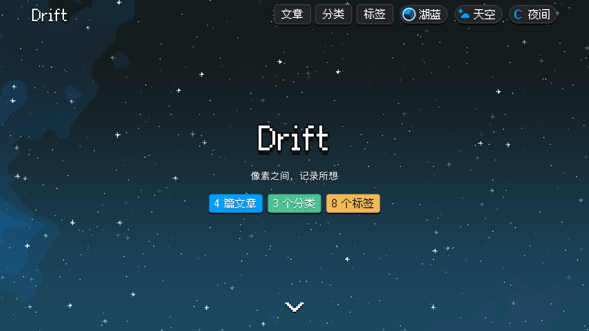
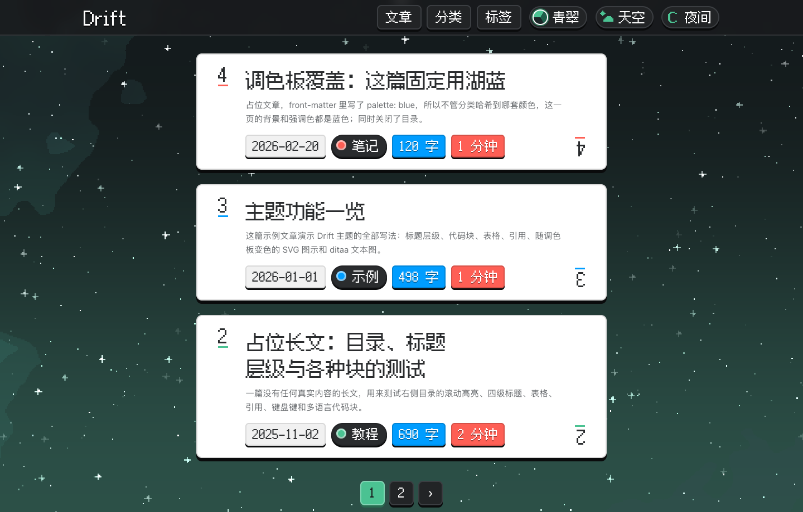
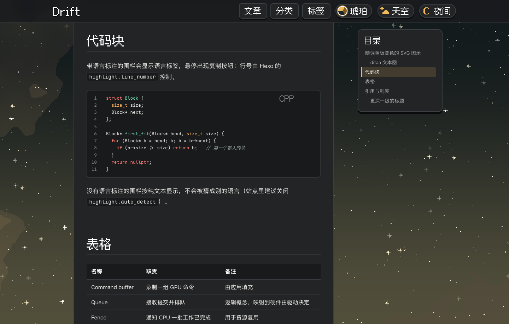
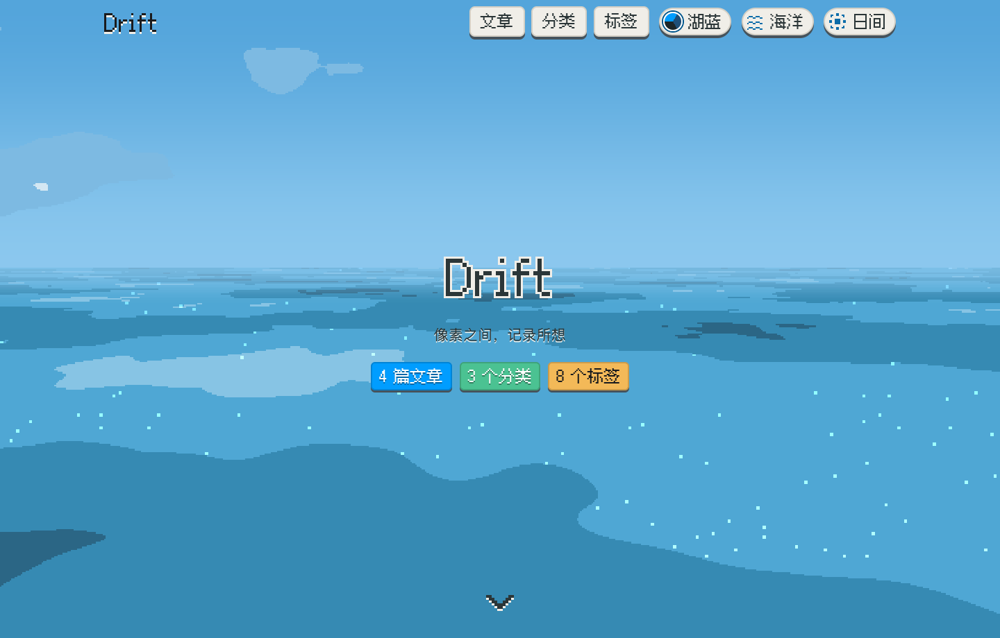
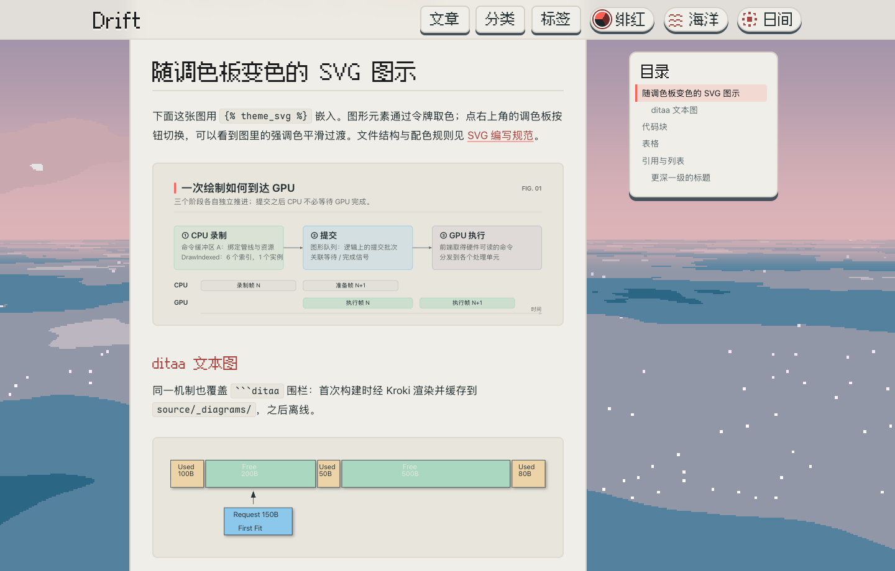
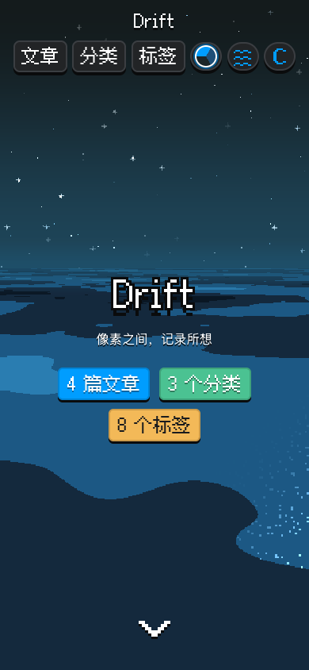
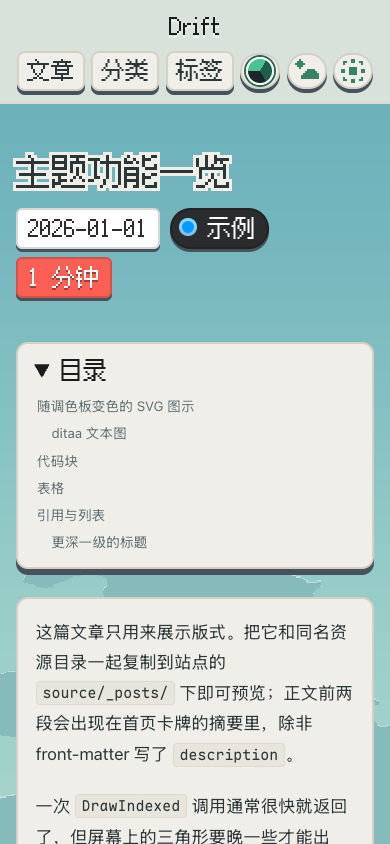

# Drift

[English](README.md) · **简体中文**

像素风景、卡牌版式，也适合慢慢读完一篇长文。为 [Hexo](https://hexo.io) 打造。



## 特性

| 卡牌列表与调色板 | 代码高亮与粘性目录 |
| --- | --- |
| [](docs/images/cards.png) | [](docs/images/reading.png) |
| **日夜切换 · 天空与海洋** | **随主题变色的 SVG 与 ditaa 图示** |
| [](docs/images/home-day.png) | [](docs/images/diagrams.png) |

动态背景 · 四套调色板 · 代码复制 · 阅读时长 · 可选 WebP · 遵循系统减少动画设置

## 手机上的样子

<p align="center">
  
  &nbsp;&nbsp;
  
</p>

截图来自仓库内的 [example 示例站](example)。点击桌面预览可查看大图。

## 本地预览

示例站使用 Hexo 8，需要 Node.js ≥ 20.19。

```sh
git clone https://github.com/FrostyLeaves/hexo-theme-drift.git
cd hexo-theme-drift/example
npm install
npm run server
```

打开 **http://localhost:4000**。示例站会直接链接主题源码。

**[安装到博客](docs/guide.zh-CN.md#installation)** · [主题配置](docs/guide.zh-CN.md#configuration) · [SVG 规范与图示](docs/guide.zh-CN.md#svg-contract) · [主题开发](docs/guide.zh-CN.md#development) · [问题反馈](https://github.com/FrostyLeaves/hexo-theme-drift/issues)

npm 包尚未发布，目前请按指南从源码安装。

## 许可证

主题采用 [MIT](LICENSE)；内置的 [缝合像素字体](source/fonts/FusionPixel-LICENSES.txt) 与 [Maple Mono](source/fonts/OFL.txt) 采用 SIL OFL 1.1。像素与卡牌的视觉风格受 Balatro 启发，不含游戏资源。
