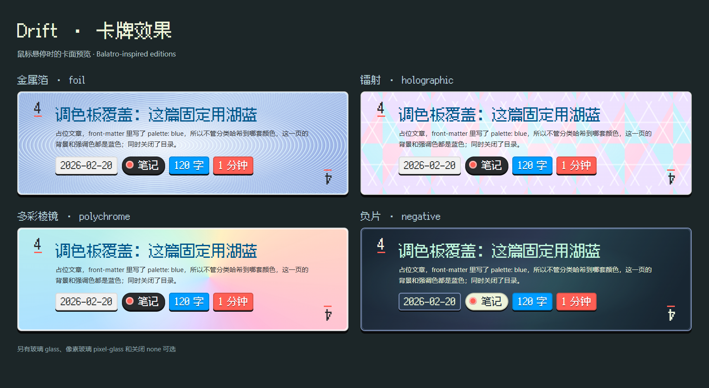

# Drift 使用指南

[English](guide.en.md) · **简体中文** · [返回截图展示](../README.zh-CN.md)

[安装](#installation) · [配置](#configuration) · [图示](#diagrams) · [WebP](#webp) · [开发](#development)

<a id="installation"></a>
## 安装

Drift 需要 Hexo ≥ 7、`hexo-renderer-ejs` 和一个 Markdown 渲染器，例如 `hexo-renderer-marked`。Node.js 版本需满足所安装的 Hexo 和可选 Sharp 依赖。仓库内的示例站使用 Hexo 8，需要 Node.js ≥ 20.19。

### 从源码安装

在现有 Hexo 站点中运行：

```sh
git clone https://github.com/FrostyLeaves/hexo-theme-drift.git themes/drift
npm install hexo-renderer-ejs
```

如需 WebP 转换，在站点中再运行 `npm install sharp`。沿用站点已有的包管理器；pnpm 站点请使用 `pnpm add`。

如果博客需要用子模块跟踪主题源码，将克隆命令替换为：

```sh
git submodule add https://github.com/FrostyLeaves/hexo-theme-drift.git themes/drift
```

在其他机器检出博客时，使用 `git clone --recurse-submodules`，或克隆后执行 `git submodule update --init --recursive`。站点的 Node 依赖仍需单独安装。

### 首次发布后，通过 npm 安装

npm 包尚未发布。发布后将优先推荐这种安装方式：

```sh
npm install hexo-theme-drift hexo-renderer-ejs
```

主题会安装到 `node_modules/hexo-theme-drift/`。同一站点使用一种安装方式即可；从源码切换到 npm 前，先移走 `themes/drift` 中的源码副本。

### 启用主题

在站点 `_config.yml` 中设置：

```yaml
theme: drift
post_asset_folder: true
highlight:
  auto_detect: false
```

创建 `source/categories/index.md` 和 `source/tags/index.md`，分别写入以下 front matter：

```yaml
---
title: 分类
type: categories
---
```

```yaml
---
title: 标签
type: tags
---
```

保留 Hexo 常用的 archive、category、index、tag 生成器，示例站的 [package.json](../example/package.json) 列出了完整依赖。然后构建并预览：

```sh
npx hexo clean
npx hexo generate
npx hexo server
```

SVG 图示的编写规则见本指南的 [SVG 文件规范](#svg-contract)。站点中不要再保留主题插件的同名副本，例如 `scripts/theme-svg.js`，以免重复注册。

<a id="configuration"></a>
## 配置

在**站点根目录**创建 `_config.drift.yml`，只写需要覆盖的配置，不直接修改安装后的主题。所有默认值见 [_config.yml](../_config.yml)。

```yaml
hero:
  title: 我的笔记
  subtitle: 记录代码、图形与途中所想
background:
  style: sky
  styles: [sky, ocean]
  mode: auto
  speed: 1
palette:
  home: blue
  post: auto
post:
  toc: true
```

也可以把覆盖项放在站点 `_config.yml` 的 `theme_config:` 下。`theme_svg`、`diagrams`、`webp` 三个插件还会优先读取站点配置中的同名顶层配置块。

| 配置项 | 用途 |
| --- | --- |
| `nav` | 导航名称与路径；名称从 `languages/*.yml` 读取。 |
| `i18n.enable / default / languages` | 界面语言切换、默认语言与可选语言。 |
| `hero.enabled / title / subtitle / typing / stats / height` | 首页开屏、标题、打字效果、计数与高度。 |
| `index.intro / excerpt_length` | 关闭开屏后的简介；卡牌摘要长度。 |
| `post.toc / toc_max_depth / show_updated / reading_speed / license_links` | 目录、文章信息、阅读时长估算与许可证链接。 |
| `palettes` | 各套调色板的背景色与强调色。 |
| `palette.home / post / pool / archive / category / tag / page / error` | 各类页面的配色；`post: auto` 按首个分类从 `pool` 中固定选择。 |
| `background.enable / style / styles / mode / speed / fps / pixel_filter` | 天空或海洋、初始昼夜、动画速度、帧率与像素分辨率。 |
| `juice.tilt / wobble / foil / text` | 卡牌倾斜、待机摇摆、悬停反光风格与文字动效。 |
| `utterances` | 使用 GitHub 的评论系统。 |
| `footer.start_year / links` | 版权起始年份与页脚链接。 |
| `favicon` | ICO、PNG 与 Apple touch 图标。 |
| `theme_svg / diagrams / webp` | 主题内置的构建插件。 |

### 界面语言

顶栏的 `中 / EN` 按钮用于切换界面语言，选择会保存在浏览器中，刷新和打开其他页面时继续生效。默认支持中文和英文，默认语言取站点 `language` 的第一项，也可单独指定：

```yaml
i18n:
  enable: true
  default: zh-CN
  languages: [zh-CN, en]
```

切换范围包括导航、统计、阅读信息、目录、复制按钮、页脚、错误页以及外观按钮的文案。文章标题、正文、分类和标签名称使用作者提供的内容，不自动翻译。文章可用 front matter 的 `lang` 标注正文语言。

`enable: false` 时使用默认语言并隐藏切换按钮；`languages` 只保留一项时也隐藏按钮。增加语言时，在主题 `languages/<语言代码>.yml` 中补充词条并加入 `languages`；用 `language.name` 和 `language.short` 定义该语言的名称与按钮缩写，缺少的词条回退到英文 `default.yml`。

### 外观与动画

- `sky`、`ocean` 各有日间与夜间场景。读者可在顶栏切换场景、昼夜和调色板，选择会保存在浏览器中。昼夜按钮依次切换“自动 → 日间 → 夜间”；“自动”会实时响应系统配色变化。
- `background.mode` 默认是 `auto`（随系统），也可设为 `day` 或 `night`。浏览器中已有的手动选择优先；切回“自动”即可恢复自动切换。关闭动态背景后仍可切换昼夜。
- 默认调色板是 `blue`、`green`、`gold`、`red`。在 `palettes` 下增加配色，在此处或 `languages/` 中定义标签，再把名称加入 `palette.pool` 即可参与文章自动配色。
- `background.styles` 只留一项时隐藏场景按钮。`background.enable: false` 使用静态渐变；浏览器不支持 WebGL 时也会回退到渐变。
- `juice.text` 支持 `hero`、`titles`（默认）、`all`。各动效项设为 `false` 可关闭。主题遵循系统的减少动画设置，标签页隐藏时暂停背景动画。
- 日间颜色在 `source/css/main.css` 的 `:root[data-mode="day"]` 中。修改令牌时保留图示依赖的三个 `--color-*` 输入变量。

卡牌效果通过 `juice.foil` 选择，卡牌倾斜仍由 `juice.tilt` 单独控制。随主题提供的默认配置为 `pixel-glass`，例如可改成参考 Balatro 的负片效果：

```yaml
juice:
  tilt: true
  foil: negative
```

| `juice.foil` | 效果 |
| --- | --- |
| `foil` | 蓝色金属箔，以鼠标位置为中心的细密同心反光纹。 |
| `holographic` | 镭射，粉彩光谱与三角晶格随鼠标移动。 |
| `polychrome` | 多彩棱镜，大面积彩虹色域与移动高光。 |
| `negative` | 负片，深蓝卡面、浅薄荷色文字与青紫反光。 |
| `glass` | 玻璃反光，柔和高光与斜向亮带。 |
| `pixel-glass` | 像素玻璃，方格纹理、阶梯形反光条，按 16 像素步进跟随鼠标。 |
| `none` | 关闭卡面效果。 |

前四种效果参考 Balatro 卡牌版本的视觉特征，以适合文章卡牌阅读的 CSS 实现，反光位于文字下方。鼠标悬停或用键盘聚焦卡牌链接时生效，离开后恢复普通卡面。



旧配置 `foil: true` 等同于 `holographic`，`foil: false` 等同于 `none`，未配置或无效值回退到 `holographic`。卡面效果不拦截链接操作；触摸设备和系统的减少动画模式下关闭，也不增加图片下载或持续渲染循环。

### 文章 front matter

```yaml
---
title: 一篇渲染笔记
description: 显示在文章卡牌上的简短摘要
categories:
  - 图形学
tags:
  - GPU
palette: gold
toc: true
comments: false
license: CC BY 4.0
---
```

卡牌摘要依次取 `description`、`<!-- more -->` 前的内容、文章开头。单篇文章可用 `toc: false` 或 `comments: false` 关闭目录和评论。背景场景与昼夜不支持 front matter 覆盖。宽表格和代码块在文章内部横向滚动。

### 评论

在用于评论的仓库安装 [Utterances](https://utteranc.es/)，然后配置：

```yaml
utterances:
  enabled: true
  repo: your-name/your-comments-repo
  issue_term: title
  label: utterances
```

评论会跟随 Drift 的昼夜模式。目前没有内置站内搜索。

<a id="diagrams"></a>
## 图示

插件由主题的 `scripts/` 自动加载，不需要另装 Hexo 图示插件。完整写法见[示例文章](../example/source/_posts/theme-showcase.md)。

### 随主题变色的 SVG

启用 `post_asset_folder: true` 后，把 SVG 放进文章资源目录：

```jinja

```

插件会内联 SVG、为 ID 添加前缀，并把页面颜色映射成图示令牌。同一张图就能通过 CSS 跟随调色板与昼夜模式变化，不需要客户端脚本改写 SVG，也不需要生成多份图片。手写图示和脚本生成的 SVG 都应遵循下面的规定。

<a id="svg-contract"></a>
### SVG 文件规范

#### 结构与无障碍

- 根元素必须是 `<svg>`，`xmlns` 的值为 `http://www.w3.org/2000/svg`，并包含 `viewBox="0 0 W H"`、`class="theme-diagram"`、`data-theme-svg="1"`、`role="img"`，以及指向标题和描述的 `aria-labelledby`。`width`、`height` 可作为固有尺寸，实际显示大小由主题控制。
- 根元素后紧接非空的 `<title id="…-title">`，建议随后添加 `<desc id="…-desc">`。`aria-labelledby` 只引用实际存在的 ID；没有描述时只引用标题。
- 标题和描述后放置权威 `<style>` 令牌块。可从下方完整示例原样复制，不修改派生公式。[lib/theme-svg-contract.js](../lib/theme-svg-contract.js) 中的 `TOKEN_STYLE` 是唯一权威副本。
- 手写或脚本生成的文件，所有 ID 以文件名去掉扩展名后的部分为前缀，例如 `01-example-title`、`01-example-arrow`。插件内联时再添加一层前缀，重复使用同一张 SVG 也不会冲突。Kroki 缓存的前缀由转换器自动生成。
- 文字使用 `<text>`，字体继承令牌块。不要在单个元素上设置 `font-family`，不要把文字转成位图。

#### 配色规则

这些规则适用于 `fill`、`stroke`、`stop-color`、`flood-color`、`lighting-color`、`color`，无论它们写在 SVG 属性、内联样式还是样式表中。

| 用途 | 规定 |
| --- | --- |
| 主题颜色 | 使用 `var(--d-*)` 令牌。 |
| 更淡的面或更弱的线 | 从令牌派生，例如 `color-mix(in srgb, var(--d-teal) 9%, var(--d-bg))`。 |
| 不绘制或继承颜色 | 允许 `none`、`currentColor`、`context-fill`、`context-stroke`。 |
| 当前 SVG 内的渐变或图案 | 使用 `url(#id)` 引用，其内部颜色也必须遵循同样的规则。 |
| 字面颜色 | 十六进制、RGB/HSL 和颜色名只允许出现在权威令牌块的自定义属性定义中，或 `var(--token, 回退值)` 的回退值中。不要给图形元素或新配色公式添加字面颜色。 |

不要假设画布固定为白色或深色。正文文字使用 `--d-ink` 或 `--d-muted`，分类色用于面和线。独立打开 SVG 时使用令牌块中的回退色，嵌入页面时继承页面或面板颜色。箭头的 `<marker>` 可用 `fill="context-stroke"` 跟随线条颜色。

#### 禁止内容

- `<script>`、`<foreignObject>`、`<image>` 和 `on*` 事件属性。
- 外部引用，包括远程 `href`、外部 `url(...)` 和 CSS `@import`。渐变、图案及其他引用应留在同一张 SVG 内。
- 栅格化文字或阴影。截图、照片请作为独立的位图资源使用。
- 用 Markdown 图片、`` 或 `` 嵌入图示 SVG。请使用 `` 让图示继承主题颜色；位图仍可使用 `asset_img`。

#### 令牌

SVG 只读取主题或插件提供的 `--diagram-*` 输入，不在文件内重新定义。图形元素使用派生后的 `--d-*` 令牌。

| 输入 | 来源或用途 |
| --- | --- |
| `--diagram-background` | `--color-background`：页面或局部面板背景。 |
| `--diagram-text` | `--color-text`：主文字与轮廓。 |
| `--diagram-accent` | `--color-accent-1`：当前调色板的强调色。 |
| `--diagram-teal`、`--diagram-blue`、`--diagram-purple`、`--diagram-orange` | 可选的 `--color-diagram-*` 分类色；没有提供时由权威公式派生。 |
| `--diagram-font` | 从主题或容器继承的可选字体栈，默认使用系统无衬线字体。 |

| 派生令牌 | 用途 |
| --- | --- |
| `--d-bg / --d-ink / --d-accent` | 背景、主墨色与强调色。 |
| `--d-muted` | 次级文字与辅助线：68% 墨色混合背景。 |
| `--d-border` | 边框：19% 墨色。 |
| `--d-surface` | 轻微抬起的面板：3% 墨色。 |
| `--d-shadow` | 阴影：35% 黑色混合背景。 |
| `--d-teal / --d-blue / --d-purple / --d-orange` | 分类用的面与线。 |

Drift 提供全部七个颜色输入，并在文章图示面板上局部覆盖背景。插件让填充与描边随配色渐变，同时遵循减少动画设置。把插件适配到其他主题时，可通过 `theme_svg.css_variables` 中的 `background`、`text`、`accent`、`teal`、`blue`、`purple`、`orange` 映射不同名称的变量。颜色应由主题或容器调整，图示文件本身不感知具体配色。

#### 可直接使用的完整 SVG

把下面的内容保存为文章资源目录中的 `01-example.svg`。其中的 `<style>` 是完整权威令牌块，包含独立打开文件时的回退颜色。

```svg
<svg xmlns="http://www.w3.org/2000/svg" viewBox="0 0 1080 280"
     class="theme-diagram" data-theme-svg="1" role="img"
     aria-labelledby="01-example-title 01-example-desc">
<title id="01-example-title">Theme-aware SVG</title>
<desc id="01-example-desc">A panel and its text inherit the current theme colors.</desc>
<style>
.theme-diagram {
  --d-bg: var(--diagram-background, #ffffff);
  --d-ink: var(--diagram-text, #383838);
  --d-accent: var(--diagram-accent, #2bbc8a);
  --d-muted: color-mix(in srgb, var(--d-ink) 68%, var(--d-bg));
  --d-border: color-mix(in srgb, var(--d-ink) 19%, var(--d-bg));
  --d-surface: color-mix(in srgb, var(--d-ink) 3%, var(--d-bg));
  --d-shadow: color-mix(in srgb, #000000 35%, var(--d-bg));
  --d-teal: var(--diagram-teal, color-mix(in srgb, var(--d-accent) 76%, var(--d-ink)));
  --d-blue: var(--diagram-blue, color-mix(in srgb, var(--d-accent) 28%, #6c91bc));
  --d-purple: var(--diagram-purple, color-mix(in srgb, var(--d-accent) 15%, #a18ab9));
  --d-orange: var(--diagram-orange, color-mix(in srgb, var(--d-accent) 10%, #d3a462));
  font-family: var(--diagram-font, -apple-system, BlinkMacSystemFont, "Segoe UI", "PingFang SC", "Microsoft YaHei", sans-serif);
}
.theme-diagram text { font-family: inherit; }
</style>
<rect width="1080" height="280" fill="var(--d-bg)"/>
<rect x="36" y="36" width="1008" height="208" rx="8"
      fill="var(--d-surface)" stroke="var(--d-border)" stroke-width="1.3"/>
<text x="68" y="112" font-size="30" fill="var(--d-ink)">Theme-aware SVG</text>
<text x="68" y="162" font-size="20" fill="var(--d-muted)">One diagram, every palette.</text>
</svg>
```

用 `` 嵌入。[流水线示例](../example/source/_posts/theme-showcase/01-pipeline.svg) 还展示了时间轴和箭头的写法。

复杂图示建议使用宽 1080 的画布、36 的边距、至少 17 的正文字号、30 的标题字号、8 的圆角和 1.3 的框线。生成脚本也应通过常量引用令牌，例如 `INK = 'var(--d-ink)'`，不要用字面颜色或栅格化文字固定外观。

#### 独立文件配色与校验

提交的配置应保持 `theme_svg.strict: true`。构建时执行校验并报告发现的违规项，编写和审阅图示时仍以以上完整规则为准；`strict: false` 仅用于排查。页面内图示跟随实时配色，单独打开或下载的 SVG 使用 `theme_svg.colors`：

```yaml
theme_svg:
  strict: true
  colors:
    background: '#222426'
    text: '#e6e4e0'
    accent: '#f3b958'
    teal: '#4bc292'
    blue: '#009dff'
    purple: '#8867a5'
    orange: '#f3b958'
```

在**站点根目录**手动校验，按安装方式选择路径：

```sh
# 源码安装
node themes/drift/tools/check-theme-svg.js

# npm 安装
node node_modules/hexo-theme-drift/tools/check-theme-svg.js
```

默认检查 `source/_posts` 和 `source/_diagrams`，也可传入文件或目录。退出码非 0 表示校验失败。图示缓存目录之外没有 `data-theme-svg="1"` 标记的文件会被报告为跳过，请确认已检查数量覆盖了预期的图示。`--update-tokens` 会先把令牌块替换为权威版本再校验。

<a id="svg-contract-maintenance"></a>
#### 维护规范

修改令牌公式或校验规则时，同一次变更必须更新两份语言指南、`lib/theme-svg-contract.js` 的 `TOKEN_STYLE` 与 `validate`，以及各生成脚本的令牌模板。用 `--update-tokens` 更新已有图示，删除受影响的 `source/_diagrams/` 缓存，执行 `hexo clean` 后重新构建、生成并校验。仓库示例站的对应路径位于 `example/` 下，重新生成的缓存应与规则变更一起提交。

### ditaa 文本图

围栏语言后的文字作为图题：

````markdown
```ditaa 空闲链表
+--------+     +--------+
| 8B     |---->| 16B    |
| cE99   |     | c6B8   |
+--------+     +--------+
```
````

首次构建向 Kroki 请求渲染，将结果规范化、校验后缓存到 `source/_diagrams/ditaa/`。提交缓存，后续构建就不必访问渲染服务。网络失败时退回普通代码块并输出警告。

```yaml
diagrams:
  enable: true
  server: https://kroki.io
  languages: [ditaa]
  cache_dir: source/_diagrams
  timeout: 30000
```

修改围栏内容会生成新缓存。要重新生成内容没变的图，删除对应缓存后先运行 `hexo clean` 再构建。`languages` 可加入其他 Kroki 语言，它们使用同样的规范化规则。

<a id="webp"></a>
## WebP

Sharp 是可选依赖。源码安装需在站点运行 `npm install sharp`；npm 安装会将其作为可选依赖安装。无法加载时，插件记录错误并保留原图。

```yaml
webp:
  enable: true
  quality: 82
  max_width: 1600
  min_size: 30720
  extensions: [jpg, jpeg, png]
  exclude: []
```

符合条件的 JPEG/PNG 在构建时转换为 WebP，对应的 `asset_img`、`asset_link` 和 Open Graph 引用也会更新。源文件不变，小图和 favicon 会跳过。`exclude` 接受匹配输出路径的正则表达式。

<a id="development"></a>
## 开发

```sh
git clone https://github.com/FrostyLeaves/hexo-theme-drift.git
cd hexo-theme-drift/example
npm install
npm run server
```

示例站只包含演示内容。`prebuild` 和 `preserver` 钩子调用 `link-theme.js`，把 `themes/drift` 链接到仓库根目录：macOS/Linux 使用相对软链接，Windows 使用 junction。重复执行会复用正确链接；旧复制目录会先保留为 `drift.backup-<时间戳>`。可用 `npm run link:theme` 手动执行，`npm run sync` 是兼容别名。

直接修改根目录的 `source/`、`layout/`、`languages/` 或 `_config.yml` 后刷新浏览器即可。修改 `scripts/` 或 `lib/` 中的构建插件后需重启服务。示例配置的 `ignore` 排除了链接内嵌套的 `example/`，避免递归监听。`themes/`、`public/`、`node_modules/` 不入库。

在 `example/` 中验证：

```sh
npm run clean
npm run build
npm run check:svg
```

在仓库根目录运行 `npm pack --dry-run` 检查打包内容。发布前还需将生成的 `.tgz` 安装到全新的 Hexo 站点，验证页面与插件；软链接示例站不能代替安装包验收。

### 目录索引

| 路径 | 用途 |
| --- | --- |
| `layout/` | EJS 页面模板与局部模板。 |
| `source/css/` | 布局、调色板、昼夜令牌和字体。 |
| `source/js/theme.js` | 切换按钮、卡牌动效、阅读交互和评论。 |
| `source/js/background.js` | WebGL 天空与海洋场景。 |
| `scripts/` | Hexo 辅助函数、过滤器与构建插件。 |
| `lib/theme-svg-contract.js` | SVG 权威令牌与校验规则。 |
| `example/` | 本地演示站与构建样例。 |
| `docs/images/` | 中英文 README 共用的浏览器实拍截图。 |

新增背景场景时，同步修改 `source/js/background.js` 的 `SCENES`、`scripts/helpers.js` 中的场景注册、顶栏图标和翻译。改字体时调整 `source/css/fonts.css` 与 `--font-pixel`，像素字使用原生字号的整数倍更清晰。

```sh
python tools/make-pixel-font.py --src /path/to/zh_hans.ttf
python tools/make-favicon.py --star '#009dff'
```

### 排查与升级

- `sharp` 警告可能表示依赖未安装，也可能是加载失败；查看附带错误并核对运行时和平台兼容性。
- 删除图示缓存后执行 `hexo clean`，避免复用旧的文章渲染结果。
- `hexo server -s` 提供静态快照，主题或插件改变后需重启。
- 从旧名 `doubleye` 升级时，将主题配置改为 `theme: drift`，站点覆盖文件改名为 `_config.drift.yml`。浏览器尚未保存 Drift 偏好时会迁移原有选择。
- 2.0 移除了 `default_mode`、`panel`、`diagram_panel` 和 `hero.image`。初始昼夜模式使用 `background.mode`。

## 致谢与许可证

主题代码采用 [MIT](../LICENSE)。[缝合像素字体](../source/fonts/FusionPixel-LICENSES.txt) 与 [Maple Mono](../source/fonts/OFL.txt) 子集保留 SIL OFL 1.1 许可证。视觉方向受 Balatro 启发，不含游戏资源。主题使用 EJS、原生 CSS 与浏览器 JavaScript，不依赖 jQuery 或图标字体。
